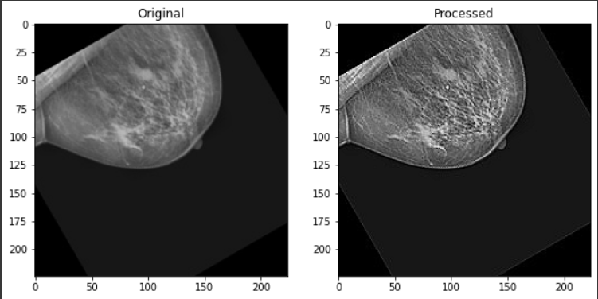
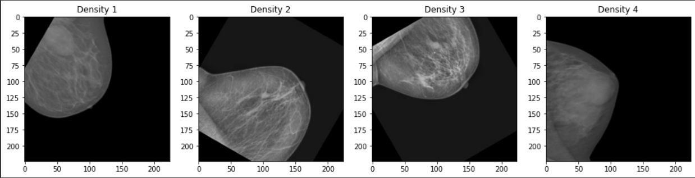
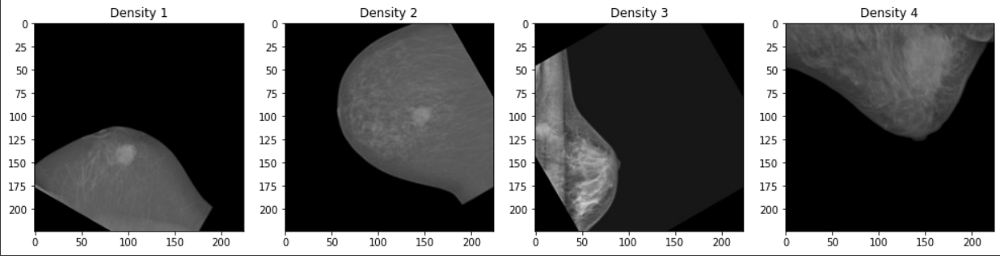

# OncologyBreastScanner for Breast Cancer Detection

Breast cancer is one of the most common malignancies among women, and early detection can significantly reduce mortality. Mammography uses X-ray images to reveal early signs of breast cancer, sometimes up to three years before a lump can be felt. Mammograms also show breast density, and people with dense breasts have a higher risk of breast cancer.

This project classifies mammogram images into eight categories combining benign or malignant findings with breast density from 1 to 4.

## Project Overview

The model uses a **DenseNet201** backbone fine-tuned for this classification task. A shared preprocessing and inference layer is used by the **Streamlit** interface, which lets users upload a mammogram and review the predicted class and all eight class probabilities.

## Features

- **Deep learning classification:** DenseNet201 classifies images into eight benign/malignant and density categories.
- **Streamlit interface:** upload, example cases, class probabilities, and a visual guide.
- **Shared inference layer:** the same preprocessing and prediction code is used by the app and tests.
- **Low-confidence handling:** predictions below 30% are reported as low confidence instead of a category.
- **In-memory processing:** uploaded images and prediction history are not stored by the app.

### Density Categories

- **1** — almost entirely fatty
- **2** — scattered areas of fibroglandular density
- **3** — heterogeneously dense
- **4** — extremely dense

### Classification Categories

1. Benign with Density = 1
2. Malignant with Density = 1
3. Benign with Density = 2
4. Malignant with Density = 2
5. Benign with Density = 3
6. Malignant with Density = 3
7. Benign with Density = 4
8. Malignant with Density = 4

## Technologies Used

- **TensorFlow / Keras:** DenseNet201 model and inference.
- **OpenCV:** resizing, sharpening, and image preprocessing.
- **Streamlit:** web interface.
- **NumPy:** image arrays and probability handling.
- **Pillow:** reading uploaded images.

## How the Project Works

1. **Upload:** the user selects a mammogram in the Streamlit app.
2. **Preprocess:** the image is converted to RGB, resized to 224 × 224, sharpened, and normalized to 0–1.
3. **Predict:** DenseNet201 produces a probability for each of the eight classes.
4. **Review:** the app shows the most likely class or a low-confidence warning, followed by every class probability.

### Workflow Images




### Tissue Examples

#### Benign



#### Malignant



## Model Weights

The weights file is not committed to the repository. At startup, the app resolves weights in this order:

1. A local `weights/modeldense1.h5`.
2. A direct download URL from the `MODEL_WEIGHTS_URL` environment variable or Streamlit secret.
3. The original public Google Drive file through `gdown`.

For a reliable deployment, host the weights at a stable direct URL and configure it in Streamlit:

```toml
# .streamlit/secrets.toml
MODEL_WEIGHTS_URL = "https://example.com/modeldense1.h5"
```

You can also set it as an environment variable:

```bash
export MODEL_WEIGHTS_URL="https://example.com/modeldense1.h5"
```

Google Drive links can be rate-limited or blocked by download quotas, so they are only a fallback.

## Run Locally

Python 3.11 is recommended because TensorFlow 2.15 supports Python 3.9–3.11.

```bash
git clone https://github.com/Gus-D-Goat/breast-cancer-detection.git
cd breast-cancer-detection
git checkout streamlit

python3.11 -m venv .venv
source .venv/bin/activate
pip install -r requirements.txt
streamlit run streamlit_app.py
```

Open `http://localhost:8501`.

To start from a downloaded set of weights:

```bash
mkdir -p weights
cp /path/to/modeldense1.h5 weights/modeldense1.h5
```

## Deploy to Streamlit Community Cloud

1. Push the `streamlit` branch to GitHub.
2. Create a new app at [share.streamlit.io](https://share.streamlit.io).
3. Select the repository, the `streamlit` branch, and `streamlit_app.py` as the main file.
4. Under **Advanced settings**, select **Python 3.11**.
5. Add `MODEL_WEIGHTS_URL` under **Secrets** if the weights are hosted outside Google Drive.
6. Deploy the app.
7. To share it privately, open **App settings → Sharing** and invite viewers by email.

Community Cloud apps sleep after inactivity and may need extra time to start while TensorFlow loads.

## Docker

A Docker fallback is included:

```bash
docker build -t oncology-breast-scanner .
docker run --rm -p 8501:8501 -e MODEL_WEIGHTS_URL="https://example.com/modeldense1.h5" oncology-breast-scanner
```

Open `http://localhost:8501`.

## Tests

```bash
python -m unittest discover -s tests -v
```

Tests that require TensorFlow or local model weights are skipped when those dependencies are unavailable.

## Project Structure

```text
.
├── streamlit_app.py       # Streamlit interface
├── inference.py           # Shared loading, prediction, and confidence logic
├── model.py               # DenseNet201 architecture
├── preprocess.py          # Image preprocessing
├── weights.py             # Weight download and caching
├── requirements.txt
├── packages.txt
├── .streamlit/config.toml
├── Test_images/           # Example mammograms
├── image/                 # Interface and documentation assets
└── tests/
    └── test_inference.py
```

## Disclaimer

This project is for research and educational purposes only. It is not a medical device and must not be used as a substitute for diagnosis or review by a qualified clinician.
